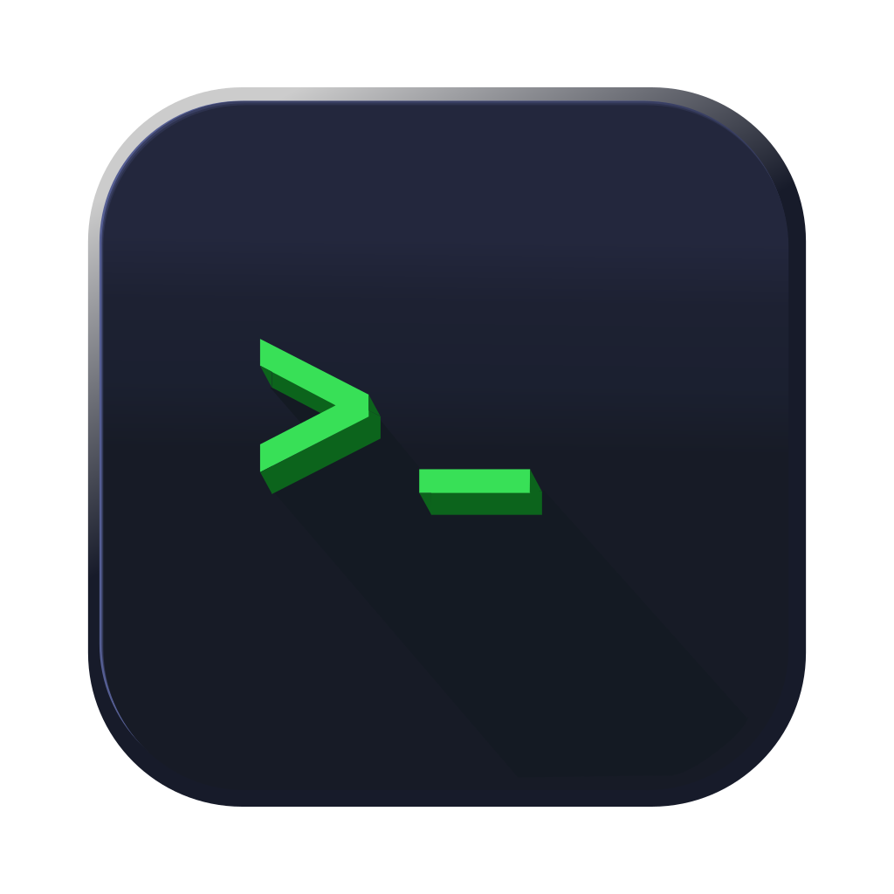

<div align=center>
  <h1 style="margin: 0;"> NEO Shell    
  </h1>
</div>


<!-- <div align="center">
      
    
</div> -->

<div align="center">

</div>

<div align=center>
  
</div>

### How it started

I wanted to build my own shell, inspired from UCB's CS162 (Operating Sys) Course.

I learned that there's insanely more depth and complexity to a shell engine than I can imagine. But at least I enjoyed doing it, learned alot about TTYs, pipes fds (Shell code in `/shell`).

From there I pivoted into building a polished terminal app instead (`/terminal_app`), running zsh behind a pseudo-terminal (`/dev/pty`). 

## Neo Shell

Neo Shell is this repo's terminal app: a native macOS window with Matrix-style rain falling behind a zsh session, with its own green prompt theme.

It used to be built with Tauri (a WebKit page with xterm.js). It's now native Swift: [SwiftTerm](https://github.com/migueldeicaza/SwiftTerm) runs zsh in a pseudo-terminal on a transparent background, and a Metal shader draws the rain underneath. The CPU only hands the GPU a step counter each frame, so with the rain on it uses about 2% CPU and 60 MB of memory, against about 10% and 143 MB for the Tauri version.

The zsh theme only applies inside Neo Shell. It loads your normal `~/.zshrc` first and never edits anything in your home folder.

### Build and run

Needs macOS 14+ and the Xcode Command Line Tools (`xcode-select --install`).

```bash
bash precheck.sh     # check the tools are installed
./run.sh             # debug build, launched straight from source
./build.sh --open    # release build → terminal_app/build/neo_shell.app
```

The first build downloads and compiles SwiftTerm, which takes about a minute.
